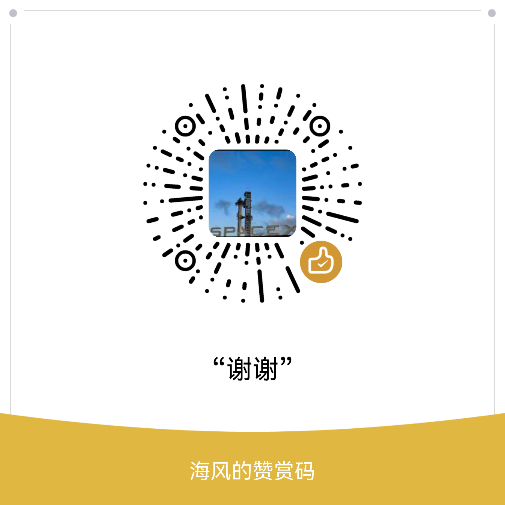

<div align="center">


<h1>hotnews · 热点新闻检索</h1>

<a href="https://github.com/kele551/hotnews/releases" title="点击去下载"></a>
<a href="https://gitee.com/kele551/hotnews/access" title="Gitee 仓库访问统计 · 实时计数"></a>

<a href="https://github.com/kele551/hotnews/blob/main/LICENSE"></a>

<a href="https://github.com/kele551/hotnews/releases"></a>


<a href="https://github.com/kele551/hotnews/stargazers"></a>
<a href="https://gitee.com/kele551/hotnews"></a>
<a href="https://github.com/kele551/hotnews/network/members"></a>
<a href="https://github.com/kele551"></a>


<a href="https://gitee.com/kele551/hotnews/releases"></a>
<a href="https://github.com/kele551/hotnews"></a>
<a href="https://www.bilibili.com/video/BV12BpQ6mEGm"></a>
<a href="https://github.com/kele551/hotnews/issues"></a>
<a href="#支持项目"></a>

<p>📰 <b>国内 / 国际热点新闻图库</b>　·　本地抓取，只看标题与原文链接</p>

<p>作者 <b>海风（kele551）</b>　·　<a href="https://gitee.com/kele551/hotnews">Gitee（主）</a>　·　<a href="https://github.com/kele551/hotnews">GitHub（镜像）</a>　·　<a href="https://atomgit.com/kele551/hotnews">AtomGit（镜像）</a>　·　<a href="docs/README_EN.md">English</a></p>
</div>

<details>
<summary>📊 <b>仓库数据一览</b>（点击展开）</summary>

<p align="center">


<a href="https://github.com/kele551/hotnews/issues"></a>


<a href="https://github.com/kele551/hotnews/blob/main/docs/CONTRIBUTING.md"></a>
</p>

</details>

## 使用

下载 [最新 Release](https://gitee.com/kele551/hotnews/releases) 里的 `hotnews-v1.5.5.exe`，双击运行，自动打开浏览器。

- 自动选端口（8000 起，被占则顺延）
- 启动时自动检查更新（可关闭，见 `config.json`）
- 页面右上角「检查更新」手动触发
- 右下角气泡提醒（见下文），点气泡可直接打开对应新闻

> **国内用户请从 Gitee 下载（速度快）**；**三个平台代码一致**：[Gitee](https://gitee.com/kele551/hotnews)（主源）· [GitHub](https://github.com/kele551/hotnews)（镜像）· [AtomGit](https://atomgit.com/kele551/hotnews)（代码镜像，只提供源码归档）。
> **二进制发行包请从 Gitee（主）或 GitHub（镜像）下载**；三个平台都收 Issue / PR。

---

## 数据源（v1.5.5）

<details>
<summary><b>数据源明细（v1.5.5）</b>（点击展开）</summary>


每个源都是**实测连通 + 带图**之后才加入的；实测失败的（无法访问、无图、停更）一律没有采用。

> **合规口径（2026-10-09 起）：只用境内站点。** 境外来源一个不留 ——
> 国际新闻也改用**境内媒体的国际版**（CGTN · 中新网·国际 · 凤凰/澎湃/红星/界面 报的国际新闻）。
> 依据、处置过程与自查方式见 [COMPLIANCE.md](docs/COMPLIANCE.md) 第 7 节。
>
> **⚠ 唯一例外（2026-10-11 用户拍板）：国际娱乐栏接入 2 家境外娱乐媒体。**
> 境内口径下国际娱乐的供给已被实测探到底 —— CGTN 英文文化分区 50 条里判得出国际的只有
> 6 条，放宽时效到 30 天一条不增；CGTN 西/法/阿/俄四语种文化分区各 200 条，各只有 2~3 条
> 娱乐；中国日报 / 环球时报英文 / 新华英文 / 人民网英文 / 中新网英文 / 中国网 的娱乐 RSS
> 全部 404；国内三家娱乐源 33 条里没有一条真国际稿。用户据此拍板接境外源补这一栏，
> 实测 20 家境外候选后只留下**唯一两家能过「每条必须带高清大图」门槛**的：
> **Variety**（10 条全带图）与 **Consequence**（15 条全带图）。
> 约束：只进国际娱乐栏，不动要闻/科技/财经/体育；加主权红线过滤；
> 总开关 `INTL_ENT_OVERSEAS`（改 `False` 即回到纯境内口径）。
> 详见 [COMPLIANCE.md](docs/COMPLIANCE.md) 第 7 节。

### 栏目定稿（2026-10-09 用户逐条确认）

**国内栏目（6 栏）**：**头条 / 科技 / 财经 / 娱乐 / 软件 / 热榜**
**国际频道（6 栏）**：**要闻 / 科技 / 财经 / 娱乐 / 体育 / 热榜**

| 栏目 | 源 |
|---|---|
| **国内热榜** | 澎湃新闻 · 红星新闻 · 凤凰网（按站方栏目分类只留国内条目；每条带 `source` 出处，界面写「来源：凤凰网热榜 · 第4名」） |
| **国内头条** | 界面新闻 · 澎湃新闻 · 凤凰网 · 红星新闻（本栏 2026-10-09 按用户口径定名为「头条」；红星/凤凰的实时热点也并入本栏） |
| **国内科技** | IT之家 · 快科技 · 爱范儿 · 雷峰网 · 极客公园（5 源） |
| **国内财经** | 华尔街见闻 · 中新网·财经（2 源）＋ 标题命中财经特征词、被 `_fix_finance_cls` 从别的栏目**改判过来**的条目（股市/基金/ETF/央行/汇率/利率/楼市/财报/IPO/关税/贸易/大宗商品/黄金/油价…） |
| **国内软件** | mefcl · 小众软件 · 少数派 · 果核剥壳 · iplaysoft（异次元） · 开源中国（6 源） |
| **国内娱乐** | 凤凰娱乐 · 新浪娱乐 · 国际在线娱乐（3 源；2026-10-09 复测了 20 多个境内娱乐入口，**没有**能新增的 —— 唯一达标的国际在线子频道与首页内容完全重合，详见 `logs\国际栏增补带图源-20261009.md`） |
| **国际要闻** | CGTN · 中新网·国际 · 国际在线·国际 · 人民网·国际 · 光明网·国际 ＋ 凤凰网 / 澎湃新闻 / 红星新闻 / 界面新闻 报的国际报道（全部境内） |
| **国际科技** | CGTN科技（1 源）＋ 国内科技源里的国际条目（按栏目分流转过来的） |
| **国际财经** | CGTN商业（1 源） |
| **国际娱乐** | CGTN文化（1 源）—— 目前**只有这一条直连源**，且逐条过国别判定（`_is_domestic_for_intl`：必须有外国具体对象、且不是国内题材），国内题材的直接不入国际栏 |
| **国际体育** | 新华网·体育 · CGTN体育（2 源，2026-10-09 补源） |
| **国际热榜** | 中新社·国际 · 凤凰网 · 澎湃新闻 · 红星新闻（4 家，全部境内；同样带 `source` 出处） |

> **栏目与源的定稿依据、历史口径与「实测失败、没有采用」清单**（民生栏整栏下线、国内体育栏下线、
> 「娱乐条目一律留在国内版」的口径、国际栏补源与换源记录、国内财经为什么只有 2 家，以及**别再重复试**
> 的失败源清单）见 [CONTRIBUTING.md](docs/CONTRIBUTING.md) 第 4.5 节。

</details>


---

## 国内 / 国际怎么分的

<details>
<summary><b>国内 / 国际怎么分的</b>（点击展开）</summary>


**用站方自己的栏目分类**，不是靠猜关键词：

- 凤凰网文章页的 JSON-LD 里有 `articleSection`（`国际` / `军事` / `台湾`…）
- 只认**已登记的栏目名**；认不出来才退回关键词判定
  （凤凰会把「独家原创」也塞进 `articleSection`，那是内容类型不是栏目，不能盲信）
- 关键词判定是「像国际 **且** 不像国内」才算国际 —— 只判前者会把
  「外交部：美方应慎重处理台湾问题」这类中国官方表态误当成国际新闻
- ⚠ `articleSection` **只决定"国内还是国际"**，从来不参与栏目命名。所以站方给的
  `大陆` / `台湾` / `时政` / `独家原创` 这类取值**不会**被当成栏目名渲染出来；
  栏目只有定稿那几栏（见上面的栏目表）。

国内栏目里判为国际的条目**不丢弃**，转给国际板块：
国内热榜 → 国际热榜；国内头条 → 国际要闻。

热榜条目一律**按时间倒序**，最新鲜的永远在最上面。

</details>


---

## 时效规则

<details>
<summary><b>时效规则</b>（点击展开）</summary>


- **头条 / 热榜：严格当天**（热榜给 24 小时，否则更新慢的榜单会整个消失）
- **垂类（科技 / 软件 / 娱乐）：按各自窗口放几天**
  —— 实测只在当天里筛，会把更新频率低的垂类源整个饿死（软件栏只剩一家）
- **财经在 `CLS_MAX_AGE_HOURS` 里没有条目** → 跟头条一样按「当天 / 24h」收口；
  `_fix_finance_cls` 因此放在时效收口**之前**调用，避免"科技窗口 96h 的股市稿"
  借着旧栏目混进财经
- **绝不伪造时间**：某一版曾用「解析不出时间就当刚刚」，导致旧闻排到热榜第一条，
  已彻底删除。时间一律取自源站或文章页的真实发布时间

</details>


---

## 图片规则

<details>
<summary><b>图片规则</b>（点击展开）</summary>


- 每条新闻**必须有高清大图**，门槛是短边 300；无图一律不上
- **RSS 本身不带图的源**自动去文章页取图：少数派 / 新浪娱乐取 `og:image`；
  中新网系（国际 / 财经）**连 `og:image` 都没有**，按站点规则从正文容器
  `<div class="left_zw">` 里取首图（优先取带「图说」的那张，避免配到相关新闻的缩略图）
- **列表页只给缩略图的源**会把地址改写成原图：国际在线娱乐的卡片图是 512×288
  （短边 288 差 12 像素过不了 300 的门槛），按站方 URL 规则去掉最后一节下发尺寸即可拿到
  991×558 ~ 4052×2278 的原图
- 这类「去正文页取首图」的源**单条限时 3 秒**、结果进缓存（文章元数据 7 天），
  取不到就跳过该条 —— 不让个别慢页面拖住整轮刷新
- **mefcl 例外**：站方题图本身就是 220×150，去正文页也换不出更大的，
  所以给它开了图质豁免（否则整个「软件」栏目会消失）
- 补图名额（一轮 96 条）**按来源轮流分配**，避免条目多的源把名额占满、
  害得别的源整轮补不到图而在页面上消失

</details>


---

## 右下角气泡提醒

<details>
<summary><b>右下角气泡提醒</b>（点击展开）</summary>


自绘窗口，**不依赖系统通知**（Windows 11 且通知总开关关闭时，系统气泡会被静默丢弃）。

一条气泡里滚动播放 **10 条**，每条 **5.6 秒**（一整组约 56 秒），标题尾部带 `(3/10)` 进度。

**第一行 = 这条自己的栏目**（2026-10-09 用户要求：原先那句与栏目无关的固定抬头已全仓库删除）：

- 头条那条显示 **`【头条】`**，并且自绘气泡给它**浅红底 + 红色强调条 + 更大的红字标题 + 红色下划线**，
  一眼就能认出是头条；
- 热榜那条显示 **`【热榜】凤凰网热榜 第4`**（用户点名「气泡里的热榜条目必须带出处」）；
- 国际条目显示 **`国际·要闻`** 这类（带频道前缀，跟国内同栏目区分开）；
- 其余就是栏目名本身：科技 / 财经 / 娱乐 / 软件。

名额**按栏目配额**挑（用户逐条定稿）：**头条 2 + 科技 2 + 财经 2 + 娱乐 2**，
剩下的 2 个席位按 **软件 → 热榜 → 国际 → 其他栏目** 补足；哪一栏当期没货就用别的栏目补满 10 条。
日志按栏目报数：`[ok] 更新提醒：滚动播放 10 条（头条2/科技2/财经2/娱乐2/软件1/热榜1）`。四条规则：

- **同一来源只取一条** —— 不然更新最勤的站点（快科技、IT之家）会把 10 个位置全占掉
- **只播中文条目**，国际新闻优先取境内媒体（凤凰 / 澎湃 / 红星 / 中新网·国际）报的，
  CGTN 那种英文条目排在后面（翻译没跟上时不会顶到前面去）
- **播过的不重复** —— 记下已播条目，一轮播完才开新一轮
- **每条停留 5.6 秒**：10 条 × 7.2 秒 = 72 秒一组实测太拖（用户多半播到第 4~5 条就切走了），
  3 秒又读不完一行标题；5.6 秒正好读得完一条（含栏目行），一组 56 秒

鼠标移到气泡上会浮出「打开 / 退出」两个按钮，并且**暂停自动关闭**（不然 5.6 秒来不及点）。
**点气泡正文或「打开」直接打开当前那条新闻的原文**（没有链接时才回落到程序首页）。

| 类型 | 触发 |
|---|---|
| 新闻更新 | 有新条目就弹，**10 分钟**最多一次（跟刷新周期一致） |
| 新闻大事 | 标题命中大事关键词，或同一件事被 ≥3 家不同来源报道 |
| ★ 我的软件被发布 | 标题命中 `MY_SOFTWARE_KEYWORDS`（壁纸助手 / 狐径 / FoxPath / kele551） |

后两类**不做时间节流**。

</details>


---

## 本地开发

<details>
<summary><b>本地开发</b>（点击展开）</summary>


```bash
pip install -r requirements.txt
python app.py            # 或 python -m uvicorn server:app --port 8000
```

> **想改代码？先看 [项目结构与上手路线](docs/ARCHITECTURE.md)** —— 15 分钟看懂：哪个文件管什么、
> 想加一个新闻源 / 改分流口径 / 改界面该动哪里、改完要跑什么。
> ⚠ 动升级链路（`version.json` / `updater.py`）前，务必先读 [CONTRIBUTING.md](docs/CONTRIBUTING.md) 第 5.2 节的两条红线。

</details>

---

## 打包

<details>
<summary><b>打包</b>（点击展开）</summary>


```bash
pyinstaller build_exe.spec --clean --noconfirm   # 产出 dist/热点新闻.exe
```

> 打包环境必须**同时装有 PyInstaller 和项目依赖**。
> ⚠ `version.json` **不能带 BOM**（用 PowerShell 的 `Set-Content -Encoding UTF8` 写会带），
> spec 里已改用 `utf-8-sig` 读取容忍；本地 `version.json` 必须保持精简（只写 `version`）。

</details>


---

## 自动更新机制

<details>
<summary><b>自动更新机制</b>（点击展开）</summary>


> **默认全自动、不弹确认框**：启动后静默检查 → 静默下载 → 验签 + 校验 sha256/尺寸 → 自动替换运行。
> **只有出问题才提示一次**，并且始终保留旧版本可继续使用。详见下面「升级体验」一节。

- 启动时后台静默检查 `version.json`（国内优先走 Gitee）
- 更新源按顺序试三个地址，**每一个都必须通过 Ed25519 验签**才被采用：
  1. `https://raw.giteeusercontent.com/kele551/hotnews/raw/master/version.json`
  2. `https://gitee.com/kele551/hotnews/raw/master/version.json`
  3. `https://raw.githubusercontent.com/kele551/hotnews/main/version.json`（GitHub 兜底）
- 发现新版 → 后台下载 exe → 校验 sha256 → 自动替换重启（替换前还会再校验一次尺寸与 sha256）
- 也可点页面「检查更新」按钮手动触发（手动触发同样不再弹确认框）

### 升级体验：默认自动、失败才提示

| 情形 | 行为 |
|---|---|
| 有新版（`auto_update=true`，默认） | 静默下载 + 验签 + 校验；**不弹任何确认框**；校验通过后自动替换并重启 |
| 后台静默实例（开机自启那种，`--silent`） | 校验通过就**立刻**替换重启，用户完全无感 |
| 前台实例（用户正在看页面） | 不打断：**退出程序时自动完成替换**（页面「退出程序」/ 托盘「退出程序」都会先装再退），下次启动就是新版 |
| 下载失败 / 验签不过 / sha 不符 / 替换没成功 | **只提示一次**：一条气泡说清原因 + 一句怎么办；**旧版本保持可用，程序不会消失** |
| `auto_update=false` | 只提示「发现新版本 vX」，**不下载、不自动升级**；由用户自己点「检查更新」 |
| `enabled=false` | 连检查都不做 |

配置写在 `config.json`（可被 `%LOCALAPPDATA%\hotnews\config.local.json` 覆盖）：

```json
{ "update": { "enabled": true, "auto_update": true } }
```

> **升级的安全底线与维护者须知**（fail-closed 的六条底线、`version.json` 与 `version.json.sig` 为什么不是一对、
> GitHub 兜底怎么保持有效、发布新版本踩过的六个坑、Gitee `master` 为什么不能强推以及两种推法）见
> [CONTRIBUTING.md](docs/CONTRIBUTING.md) 第 5.1 ～ 5.3 节。

</details>


---

## 仓库约定

- 行尾：入库与检出**一律 LF**（`.gitattributes` 的 `* text=auto eol=lf`），只有 `说明.txt` 例外、保持 CRLF。
- 关键词表放在 **`data/keywords.txt`**（国家 / 地区 / 机构 / 赛事…以纯数据形式），`server.py` 里只有加载函数 `_load_keywords()`。
- 打包前先核对清单：`python build.py --list` —— 清单里不该出现历史 exe、调试快照、PyInstaller 中间目录。

> 三条约定的完整说明（当年行尾错乱的来龙去脉、关键词表为什么搬出代码、打包排除规则的细节与例外）见 [CONTRIBUTING.md](docs/CONTRIBUTING.md) 第 3.5 节。


---

## 路线图（Roadmap）

<details>
<summary><b>路线图（Roadmap）</b>（点击展开）</summary>


下面是**真实在做、做完就会回来更新这一节**的方向，按优先级排列：

1. **继续补已实测可用的源** —— 按「真连通 + 带图（短边 ≥300）+ 有当天或近日内容」三条实测标准补源，
   让每个栏目稳定 ≥3 家网站。
   ★ 当前最缺的是 **国内「财经」（2 家）与「娱乐」（3 家，且新浪娱乐首页把当天稿子基本放在
   5 天窗口之外）**：境内财经/娱乐类站点实测下来**没有一家给出可直接用的 RSS 或干净的列表结构**
   （试过的清单见 [CONTRIBUTING.md](docs/CONTRIBUTING.md) 第 4.5 节「实测失败、没有采用的源」），
   所以先如实留成 2~3 家。没实测过的源不会写进来。
2. **移动端局域网查看** —— 让手机在同一个局域网里也能打开页面看新闻。
   现状：程序默认只监听 `127.0.0.1`，要局域网访问得用 `--host 0.0.0.0`；
   而「退出程序 / 立即更新 / 开机自启」这三个有副作用的按钮**只允许本机操作**，
   非本机访问会返回 403（见 [SECURITY.md](docs/SECURITY.md)）。
   所以要做的不是简单放开监听，而是：为小屏做自适应布局，
   并把「只读浏览」与「本机管理」在界面上分清楚。
3. **源可用性自检面板** —— 现在查「某个源怎么没内容」得开命令行跑 `check_sources.py`
   （打印每个 Region 的条数、最新 / 最旧时间、带图数、分类分布）。
   计划把它搬进页面做成可视化面板：一眼看出哪个源当前抓不到、哪个源不带图、哪个源停更了。

**维护原则**（比上面的清单更重要）：

- **不为修 bug 单独发版** —— 修复先攒着，跟下一个真功能版本一起发。
- **没测过的东西不交付** —— 发布前跑完整自检（冷启动、完整升级演练、失败分支、版本一致性），红一条不发。
- 线上每发现一个新问题，就把那一幕补成一个检查项，让同一个坑不可能踩第二次。

</details>

---

## 参与贡献与治理

- **维护者**：海风（kele551）—— 个人项目，单人维护；Issue / PR 一般 **3 个工作日内**给首次回应，能复现的问题排进下一个真功能版本（本项目不为单个问题单独发版）。
- **安全漏洞**：**请不要开公开 Issue**，按 [SECURITY.md](docs/SECURITY.md) 的私下渠道报告（首选 GitHub 仓库的私密漏洞报告入口）。
- **贡献指南**：怎么提 Issue / PR、代码风格、本地构建与自查、数据源增删的实测门槛、提交信息规范见 [CONTRIBUTING.md](docs/CONTRIBUTING.md)。
- **自动构建与产物校验**：`.github/workflows/build.yml` 在 Windows runner 上装依赖、用 `build_exe.spec` 打包、校验版本号与署名、打印每个产物的 SHA256 并上传 artifact；产物来源、SHA256 自核验、将来的代码签名计划，以及升级通道已有的 Ed25519 签名校验，见 [CODE_SIGNING_POLICY.md](docs/CODE_SIGNING_POLICY.md)。
- **第三方组件与许可**：运行时只依赖 4 个第三方库（版本在 `requirements.txt` 里固定），全部是宽松许可，**没有 GPL/AGPL、没有需要商业授权的组件**：fastapi 0.142.2（MIT）· uvicorn 0.54.0（BSD-3-Clause）· feedparser 6.0.14（BSD-2-Clause）· httpx 0.28.1（BSD-3-Clause）；传递依赖（starlette / pydantic / anyio / h11 / idna / click / certifi 等）的清单见 [COMPLIANCE.md](docs/COMPLIANCE.md) 第 5 节，其余全部是 Python 3.13 标准库。
- **许可与合规**：MIT，见 [LICENSE](LICENSE)，提交贡献即表示同意以同一许可分发；聚合与抓取边界、隐私、知识产权，以及**尚未闭环的合规事项**见 [COMPLIANCE.md](docs/COMPLIANCE.md)（第 7 节）。
- **署名与发布**：中文场景统一写「海风（kele551）」，仓库地址 https://gitee.com/kele551/hotnews ；维护者用的 `tools/publish.py`、签名私钥与发布凭据都在维护者本机工作区，**不在本仓库内**。
- **行尾与打包清单**：见上文「仓库约定」——`.gitattributes` 统一 LF（`说明.txt` 保持 CRLF）；`python build.py --list` 可以在真正打包前核对清单里没有本机调试产物。

---

## 免责声明

> 完整合规声明见 **[COMPLIANCE.md](docs/COMPLIANCE.md)**（聚合边界 / 抓取边界 / 隐私 / 第三方组件与许可 /
> 知识产权 / 尚未闭环的合规事项）。

- 本工具是**个人学习用的新闻聚合器**，只聚合各新闻网站**公开的标题、摘要与链接**，
  **不存储、不修改、不转载原文内容**。
- 所有新闻内容的**版权归原网站所有**；每条新闻都保留并显示**原文链接**，点击即跳转到来源网站。
- 图片通过链接直接引用源站（**直链引用**，不复制、不转存到本工具的分发渠道或服务器）。
- 本工具**不用于任何商业用途**，不含广告、不收费。
- **不采集、不上传任何用户数据**；唯一会把"内容"发往第三方的路径是**可选的机器翻译，默认关闭**
  （打开后国际栏的英文标题/摘要会经第三方翻译服务转中文，详见 [COMPLIANCE.md](docs/COMPLIANCE.md) 第 3 节）。
- 抓取范围仅限各站**公开的 RSS / JSON 接口与首页**（不使用任何登录态、不读取付费内容），
  每个源每轮刷新最多请求 1 次（默认 10 分钟一轮），不并发压站；站点若通过 robots.txt
  或接口说明表达不希望被访问，会按要求移除对应来源。
- 权利人如认为本工具聚合了不应聚合的内容，**请提 Issue 说明**，核实后会立即移除对应来源。

---

<a id="sponsor"></a>

## 支持项目

如果 **hotnews 热点新闻检索** 帮到了你，**给仓库点个 Star ⭐** 就是最好的支持 —— 它能让更多人看到这个项目。

如果想再进一步，也可以请作者喝杯咖啡（**完全自愿，不影响任何功能**）：

<p align="center">
  
  <br>
  <sub>微信扫一扫 · 金额随缘</sub>
</p>

> 本项目以 MIT 协议自由开源，**没有付费版、也没有付费功能**；捐赠纯属自愿，
> 与功能开放、版本更新、Issue 响应**没有任何关系**。

---

<p align="center"><sub>© 2026 海风（kele551） · MIT License · <a href="https://gitee.com/kele551/hotnews">Gitee 主仓库</a> · <a href="https://github.com/kele551/hotnews">GitHub 镜像</a></sub></p>
