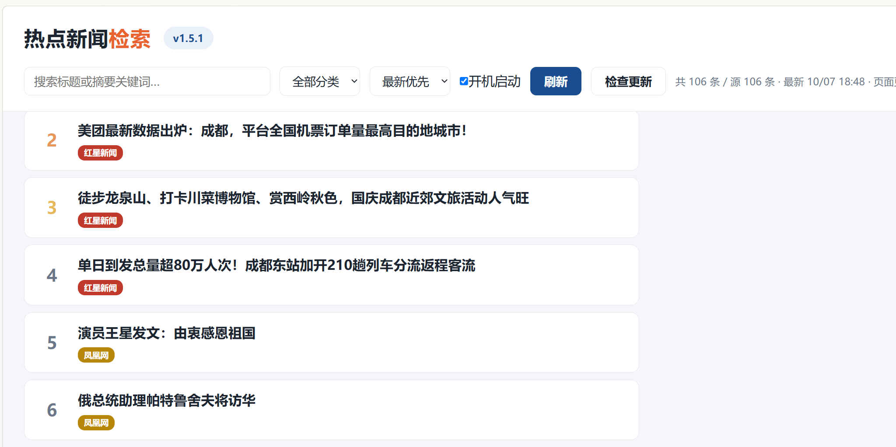
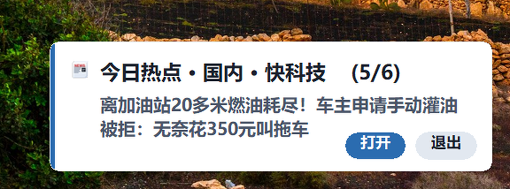

<div align="center">


<h1>hotnews · 热点新闻检索</h1>

<a href="https://github.com/kele551/hotnews/releases" title="点击去下载"></a>

<a href="https://github.com/kele551/hotnews/blob/main/LICENSE"></a>

<a href="https://github.com/kele551/hotnews/releases"></a>


<a href="https://github.com/kele551/hotnews/stargazers"></a>
<a href="https://gitee.com/kele551/hotnews"></a>
<a href="https://github.com/kele551/hotnews/network/members"></a>
<a href="https://github.com/kele551"></a>


<a href="https://gitee.com/kele551/hotnews/releases"></a>
<a href="https://github.com/kele551/hotnews"></a>
<a href="https://www.bilibili.com/video/BV12BpQ6mEGm"></a>
<a href="https://github.com/kele551/hotnews/issues"></a>
<a href="#sponsor"></a>

<p>📰 <b>网页形式的国内 / 国际热点新闻图库</b>　——　单文件 exe，双击即用，无安装、无控制台窗口，每 10 分钟自动刷新</p>

<p>作者 <b>海风（kele551）</b>　·　Gitee（主）<a href="https://gitee.com/kele551/hotnews">kele551/hotnews</a>　·　GitHub（镜像）<a href="https://github.com/kele551/hotnews">kele551/hotnews</a></p>
</div>

<details>
<summary>📊 <b>仓库数据一览</b>（点击展开）</summary>

<p align="center">


<a href="https://github.com/kele551/hotnews/issues"></a>


<a href="https://github.com/kele551/hotnews/blob/main/.github/CONTRIBUTING.md"></a>
</p>

</details>



> 上图：打开即定位在热榜（按排名倒序），顶部可切换国内 / 国际、搜索、筛分类；
> 右上角「开机启动」是给用户自己勾的开关，勾上后开机只在后台跑，不弹页面。

---

## 使用

下载 [最新 Release](https://gitee.com/kele551/hotnews/releases) 里的 `hotnews-v1.5.4.exe`，双击运行，自动打开浏览器。

- 自动选端口（8000 起，被占则顺延）
- 启动时自动检查更新（可关闭，见 `config.json`）
- 页面右上角「检查更新」手动触发
- 右下角气泡提醒（见下文），点气泡可直接打开对应新闻

> 国内用户请从 Gitee 下载（速度快）。GitHub 仓库为镜像。

<details>
<summary>📦 <b>关于本次安装包的小公告</b>（点开看）</summary>

> **本次更新了安装包，但版本号没有变。**
> 升级检查是拿「线上版本号」和「你本地的版本号」比的 —— 版本号没变，
> **已经装着同一个版本号的朋友不会收到升级提示**；比线上旧的版本仍会正常自动升级。
> 如果你用着不顺畅（例如**国际板块里混进了国内新闻**），
> 可以**重新下载最新安装包**覆盖安装一次，你的配置与收藏都会保留；更新内容以发行页说明为准。
>
> 最新安装包里，**国际板块的国别判定按「先看是不是国内主体，再看有没有具体的国际信号」重做**，
> 娱乐 / 体育 / 财经 / 科技 / 要闻 / 热榜各栏都覆盖，不再靠「全球 / 世界 / 国际」这类泛词判定；
> 仓库源码的同步会随后统一提交。

</details>

---

## 栏目与数据源（v1.5.4）

- 12 个栏目全部**实测连通 + 自带高清大图**（短边 ≥ 300）才接入；实测失败的一律不采用
- **合规口径（2026-10-09 起）：只用境内站点**；国际新闻用境内媒体的国际版。唯一例外（2026-10-11 拍板）：
  国际娱乐栏接入 2 家境外娱乐媒体（Variety · Consequence）。依据、处置与自查见 [COMPLIANCE.md](.github/COMPLIANCE.md) 第 7 节

| 栏目 | 源 |
|---|---|
| **国内热榜** | 澎湃新闻 · 红星新闻 · 凤凰网 |
| **国内头条** | 界面新闻 · 澎湃新闻 · 凤凰网 · 红星新闻 |
| **国内科技** | IT之家 · 快科技 · 爱范儿 · 雷峰网 · 极客公园 |
| **国内财经** | 华尔街见闻 · 中新网·财经 ＋ 按内容改判补足的财经条目 |
| **国内软件** | mefcl · 小众软件 · 少数派 · 果核剥壳 · iplaysoft（异次元） · 开源中国 |
| **国内娱乐** | 凤凰娱乐 · 新浪娱乐 · 国际在线娱乐 |
| **国际要闻** | CGTN · 中新网·国际 · 国际在线·国际 · 人民网·国际 · 光明网·国际 ＋ 凤凰 / 澎湃 / 红星 / 界面 的国际报道 |
| **国际科技** | CGTN科技 ＋ 国内科技源里的国际条目（分流转来） |
| **国际财经** | CGTN商业 |
| **国际娱乐** | CGTN文化（直连源，逐条过国别判定）＋ Variety · Consequence（仅有的 2 家境外源） |
| **国际体育** | 新华网·体育 · CGTN体育 |
| **国际热榜** | 中新社·国际 · 凤凰网 · 澎湃新闻 · 红星新闻 |

> 热榜类栏目一律按时间倒序；国内栏里判为国际的条目不丢弃，转给国际板块（国内热榜→国际热榜、国内头条→国际要闻）。
> 换源记录、栏目定稿过程与「实测失败、没有采用的源」完整清单见 [CONTRIBUTING.md](.github/CONTRIBUTING.md) 第九节。

---

## 设计要点

<details>
<summary><b>分流 / 时效 / 图片 / 气泡提醒</b>（点击展开）</summary>

**国内 / 国际怎么分**：用站方自己的栏目分类（凤凰网文章页 JSON-LD 的 `articleSection` 等），不靠猜关键词；
认不出才退回关键词判定（必须「像国际**且**不像国内」才算，避免把官方表态误判成国际新闻）。
`articleSection` 只决定国内还是国际，不参与栏目命名。

**时效规则**：

- 头条 / 热榜严格当天（热榜给 24 小时）；垂类（科技 / 软件 / 娱乐）按各自窗口放几天，避免低频源被饿死
- **绝不伪造时间**：解析不出就丢弃，时间一律取自源站或文章页的真实发布时间

**图片规则**：

- 每条必须有高清大图（短边 ≥ 300），无图不上
- RSS 不带图的源自动去文章页取 `og:image` 或按站方规则取正文首图（单条限时 3 秒、元数据缓存 7 天，取不到跳过该条）
- 列表页只给缩略图的源，按站方 URL 规则改写成原图地址

**右下角气泡提醒**：自绘窗口，**不依赖系统通知**。一组滚动播放 10 条、每条 5.6 秒，标题尾部带 `(3/10)` 进度；
第一行显示栏目（头条有专属红色样式、热榜条目带出处、国际条目带频道前缀）；
名额按栏目配额：头条 2 + 科技 2 + 财经 2 + 娱乐 2，其余按 软件 → 热榜 → 国际 补足；
同一来源只取一条、只播中文条目、播过的不重复。
新闻更新 10 分钟最多弹一次；「大事」（标题命中关键词或 ≥3 家来源同报）与「★ 我的软件被发布」即时弹、不节流。
鼠标悬停暂停倒计时并浮出「打开 / 退出」，点气泡正文或「打开」直接打开当前新闻原文。



</details>

---

## 自动更新

- 默认**全自动、不弹确认框**：启动后静默检查 → 静默下载 → **Ed25519 验签 + sha256 / 尺寸校验** → 自动替换重启
- 只有出问题才提示一次（说明原因 + 怎么办）；**旧版本始终可用**，替换失败可回退，程序不会消失
- 升级源依次尝试：Gitee raw ×2 → GitHub raw（兜底），三处均须验签通过才被采用
- 开关在 `config.json`（可被 `%LOCALAPPDATA%\hotnews\config.local.json` 覆盖）：

```json
{ "update": { "enabled": true, "auto_update": true } }
```

> 维护者发布流程与 `version.json` 相关的踩坑清单，见 [CONTRIBUTING.md](.github/CONTRIBUTING.md) 第八节。

---

## 路线图（Roadmap）

1. **继续补实测可用的源** —— 按「真连通 + 带图（短边 ≥300）+ 有当天或近日内容」补，目标每栏稳定 ≥3 家
   （当前缺口：国内财经 2 家、国内娱乐 3 家）
2. **移动端局域网查看** —— 为小屏做自适应布局，并把「只读浏览」与「本机管理」在界面上分清
   （现状与权限边界见 [SECURITY.md](.github/SECURITY.md)）
3. **源可用性自检面板** —— 把 `check_sources.py` 搬进页面，一眼看出哪个源抓不到、不带图、停更

> 维护原则：**不为修 bug 单独发版**（修复攒到下一个功能版本一起发）；**没测过的东西不交付**。详见 [CONTRIBUTING.md](.github/CONTRIBUTING.md) 第五节。

---

## 参与贡献

- **维护者**：海风（kele551）—— 个人项目，单人维护；Issue / PR 一般 **3 个工作日内**首次回应
- **安全漏洞**：**请不要开公开 Issue**，按 [SECURITY.md](.github/SECURITY.md) 的私下渠道报告
- **贡献指南**：怎么提 Issue / PR、代码风格、数据源增删门槛见 [CONTRIBUTING.md](.github/CONTRIBUTING.md)；
  产物来源与签名计划见 [CODE_SIGNING_POLICY.md](.github/CODE_SIGNING_POLICY.md)；
  聚合与抓取边界、隐私、第三方组件许可见 [COMPLIANCE.md](.github/COMPLIANCE.md)
- **许可**：[MIT](LICENSE)。运行时只依赖 4 个宽松许可的第三方库（fastapi / uvicorn / feedparser / httpx），
  无 GPL/AGPL、无商业授权组件，清单见 [COMPLIANCE.md](.github/COMPLIANCE.md) 第 5 节

---

## 免责声明

> 完整合规声明见 **[COMPLIANCE.md](.github/COMPLIANCE.md)**（聚合边界 / 抓取边界 / 隐私 / 第三方组件与许可 /
> 知识产权 / 尚未闭环的合规事项）。

- 本工具是**个人学习用的新闻聚合器**，只聚合各新闻网站**公开的标题、摘要与链接**，
  **不存储、不修改、不转载原文内容**。
- 所有新闻内容的**版权归原网站所有**；每条新闻都保留并显示**原文链接**，点击即跳转到来源网站。
- 图片通过链接直接引用源站（**直链引用**，不复制、不转存到本工具的分发渠道或服务器）。
- 本工具**不用于任何商业用途**，不含广告、不收费。
- **不采集、不上传任何用户数据**；唯一会把"内容"发往第三方的路径是**可选的机器翻译，默认关闭**
  （打开后国际栏的英文标题/摘要会经第三方翻译服务转中文，详见 [COMPLIANCE.md](.github/COMPLIANCE.md) 第 3 节）。
- 抓取范围仅限各站**公开的 RSS / JSON 接口与首页**（不使用任何登录态、不读取付费内容），
  每个源每轮刷新最多请求 1 次（默认 10 分钟一轮），不并发压站；站点若通过 robots.txt
  或接口说明表达不希望被访问，会按要求移除对应来源。
- 权利人如认为本工具聚合了不应聚合的内容，**请提 Issue 说明**，核实后会立即移除对应来源。

---

<a id="sponsor"></a>

## ♥️ 支持项目

如果 **hotnews 热点新闻检索** 帮到了你，**给仓库点个 Star ⭐** 就是最好的支持 —— 它能让更多人看到这个项目。

如果想再进一步，也可以请作者喝杯咖啡（**完全自愿，不影响任何功能**）：

| 微信（WeChat） | 支付宝（Alipay） |
|:---:|:---:|
|  |  |

> 本项目以 MIT 协议自由开源，**没有付费版、也没有付费功能**；捐赠纯属自愿，
> 与功能开放、版本更新、Issue 响应**没有任何关系**。

---

<p align="center"><sub>© 2026 海风（kele551） · MIT License · <a href="https://gitee.com/kele551/hotnews">Gitee 主仓库</a> · <a href="https://github.com/kele551/hotnews">GitHub 镜像</a></sub></p>
